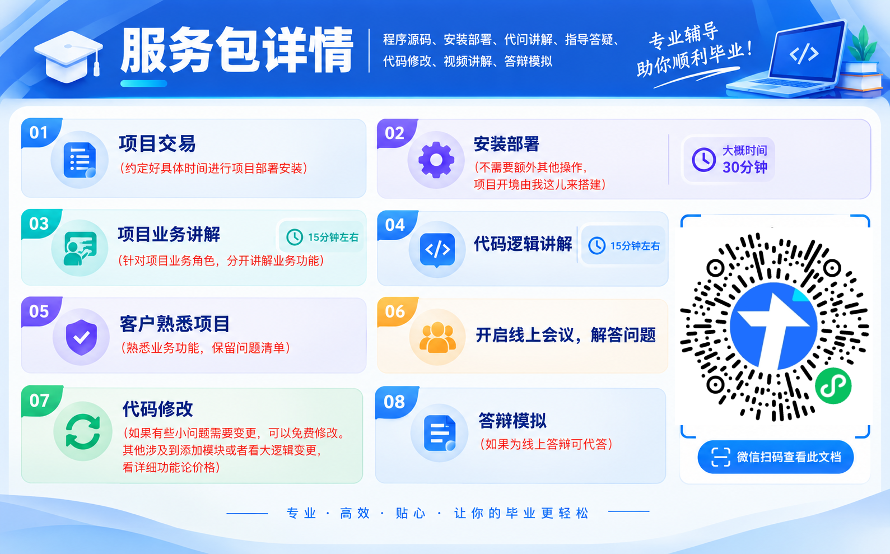

# 基于 SpringBoot + Vue 的衣装服饰小程序 (Clothing & Fashion Mini Program)

设计师入驻 · 商品交易 · 购物车结算 · 论坛社区 · 在线沟通 · 订单评价 · 数据统计 · 收货地址

本项目是一套面向服装品牌、独立设计师及穿搭爱好者的服饰交易与社区互动小程序，采用前后端分离架构，覆盖管理员、普通用户与设计师三类角色。系统围绕"商品管理、购物车结算、订单支付、设计师入驻审核、论坛社区、在线沟通、订单评价、数据统计"等核心业务设计，支持用户浏览商品、加入购物车、下单支付、发布论坛帖子、与设计师在线沟通，设计师可管理个人商品、处理订单，管理员负责平台运营、设计师审核、数据统计与内容管理，实现从商品展示、购物下单、设计师入驻到社区互动的全流程数字化管理，适用于服装品牌商城、设计师集合平台、穿搭社区小程序及服饰电商运营。

#### 安装环境
️**注意**：请确保您的开发环境已安装以下依赖。

JAVA 环境 

Node.js环境 [https://nodejs.org/en/] 选择14.17

Yarn 打开cmd， 输入npm install -g yarn !!!必须安装完毕nodejs

Mysql 数据库 一定要把账户和密码记住

redis

Idea 编译器

WebStorm OR VScode 编译器

#### 采用技术及功能

后端：SpringBoot、MybatisPlus、MySQL、Redis、
前端：Vue、Apex、Antd、Axios

平台前端：vue(框架) + vuex(全局缓存) + rue-router(路由) + axios(请求插件) + apex(图表)  + antd-ui(ui组件) + 百度地图 API

平台后台：springboot(框架) + redis(缓存中间件) + shiro(权限中间件) + mybatisplus(orm) + restful风格接口 + mysql(数据库)

开发环境：windows10 or windows7 ， vscode or webstorm ， idea + lambok

---

## 核心特性

- **设计师入驻审核**：普通用户可提交设计师认证申请，管理员审核通过后用户获得设计师身份，可发布与管理个人商品。
- **商品管理与购物车**：支持商品分类、多规格（颜色/尺码）管理、库存同步，用户可将商品加入购物车并批量结算。
- **订单与支付**：用户下单后支持在线支付，订单状态全程可追踪（待付款/待发货/待收货/已完成/已取消），支付成功后自动更新订单状态。
- **论坛社区**：用户可发布穿搭分享帖子、查看帖子详情、评论回复，形成服饰穿搭交流社区。
- **在线沟通**：用户与设计师之间支持实时消息沟通，咨询商品、定制需求或订单问题，消息记录可追溯。
- **订单评价**：用户完成订单后可对商品与服务进行评分与文字评价，评价信息供其他用户参考。
- **数据统计**：管理员可查看平台核心数据，包括用户数、订单数、销售额、热门商品、设计师入驻情况等，支持数据可视化展示。
---

## 适用场景

- 服装品牌官方商城小程序
- 独立设计师服饰集合平台
- 校园/社区穿搭分享社区
- 服装定制与设计师对接平台
- 服饰电商与社交结合的小程序
- 潮流服饰交易与交流平台
---

## 功能模块概览

## 管理员端

管理员负责平台整体运营、数据统计、内容审核与系统管理：

### 数据统计

- **数据统计**：查看平台核心运营数据，包括注册用户数、设计师数量、商品总数、订单总数、交易金额、热门商品排行、论坛帖子数等，支持按时间范围筛选与数据可视化展示（图表/报表）。

### 审核与管理

- **设计师审核**：查看用户提交的设计师认证申请，包括申请人信息、身份证认证、作品集/设计作品、申请理由，支持审核通过或驳回，并填写审核意见。
- **用户管理**：管理注册用户信息，包括姓名、手机号、注册时间、账户状态、是否为设计师，支持账号启用/禁用。
- **设计师管理**：管理已认证设计师信息，包括设计师姓名、作品数量、订单数、评分、入驻时间，支持设计师信息编辑与禁用。

### 商品与订单管理

- **商品管理**：管理全平台商品信息，包括商品名称、分类、价格、库存、规格（颜色/尺码）、商品图片、上下架状态，支持商品审核与违规商品下架。
- **订单管理**：查看所有订单列表，包括订单状态（待付款/待发货/待收货/已完成/已取消）、下单用户、商品信息、订单金额、支付状态，支持按状态、时间、用户筛选与订单处理。
- **订单评价**：查看用户对订单的评价内容、评分与标签，支持评价审核与异常评价处理，统计商品平均评分。

### 内容与沟通管理

- **论坛管理**：管理论坛帖子，包括帖子标题、内容、发布者、发布时间、评论数、点赞数，支持帖子审核、置顶与违规帖子删除。
- **论坛回复**：查看论坛帖子的评论回复内容，支持回复审核与违规评论删除。
- **公告信息管理**：发布平台公告，包括活动通知、上新提醒、系统维护通知、规则变更等，支持置顶与定时发布。
- **消息通知**：查看用户与设计师之间的沟通记录，支持消息审核与异常消息处理。

---

## 用户/设计师端

用户面向平台注册用户，设计师为通过审核认证的用户，拥有额外的商品管理权限：

### 账户与个人信息

- **我的信息**：查看与维护个人基本信息，包括姓名、手机号、头像、个人简介，设计师可编辑个人作品集与擅长风格。
- **申请设计师**：普通用户可提交设计师认证申请，填写个人信息、上传身份证认证、提交设计作品/作品集，等待管理员审核。

### 购物与支付

- **商品浏览**：浏览平台商品列表，按分类（上衣/裤装/裙装/套装等）、风格、价格等条件筛选，支持关键词搜索与排序。
- **商铺搜索**：搜索设计师商铺，查看设计师主页、商品列表与个人作品。
- **添加购物车**：将心仪商品添加到购物车，支持修改数量、选择规格（颜色/尺码）、删除商品，实时计算总价。
- **购物车结算**：选择购物车中的商品进行结算，确认收货地址与订单信息，提交订单并完成在线支付。
- **订单付款评价**：查看个人订单列表与订单状态，完成订单付款，订单完成后可对商品与服务进行评分与文字评价。

### 收货地址管理

- **收货地址新增修改**：管理个人收货地址，支持新增、编辑、删除收货地址，设置默认地址，地址信息包括姓名、手机号、省市区、详细地址。

### 论坛与沟通

- **论坛帖子查看消息回复**：浏览论坛帖子列表，查看帖子详情，发布评论回复，接收他人对自己帖子的回复通知，参与穿搭交流互动。
- **在线沟通**：与设计师实时在线沟通，咨询商品信息、定制需求或订单问题，查看历史沟通记录。

### 设计师专属功能

- **修改商品信息**：设计师可管理个人发布的商品，包括商品名称、分类、价格、库存、规格、商品图片、上下架状态，支持商品编辑与下架。
- **订单处理**：设计师查看个人商品的订单列表，处理待发货订单，更新发货状态与物流信息。

---

## 项目结构

```text
pharmacy-dispensing-system/
├── backend/            # 后端 API 服务
│   ├── src/
│   │   ├── controllers/  # 控制器
│   │   ├── models/       # 数据模型
│   │   ├── routes/       # 路由
│   │   └── services/     # 业务逻辑
│   └── package.json
├── frontend/           # 前端 Web 应用
│   ├── src/
│   │   ├── views/      # 页面视图
│   │   ├── components/ # 公共组件
│   │   └── store/      # 状态管理
│   └── package.json
├── docs/               # 项目文档与 API 接口说明
├── LICENSE
└── README.md
```
---


#### 前台启动方式
安装所需文件 yarn install 
运行 yarn run dev

#### 默认后台账户密码
[管理员]
admin
123456

#### 项目截图
|  |  |
|---------------------|---------------------|
| .jpg) | .jpg) |
| .jpg) | .jpg) |
| .jpg) | .jpg) |
| .jpg) | .jpg) |
| .jpg) | .jpg) |
| .jpg) | .jpg) |
| .jpg) |

|  |  |
|---------------------|---------------------|
| .jpg) | .jpg) |
| .jpg) | .jpg) |
| .jpg) | .jpg) |
| .jpg) | .jpg) |
| .jpg) | .jpg) |
| .jpg) | .jpg) |
| .jpg) |

#### 演示视频

暂无

#### 获取方式

Email: fan1ke2ke@gmail.com

WeChat: `Storm_Berserker`

`附带部署与讲解服务，因为要恰饭资源非免费，伸手党勿扰，谢谢理解😭`

> 1.项目纯原创，不做二手贩子 2.一次购买终身有效 3.项目讲解持续到答辩结束 4.非常负责的答辩指导 5.**黑奴价格**

> 项目部署调试不好包退！功能逻辑没讲明白包退！

<div align=center></div>

#### 其它资源
[2026年-答辩顺利通过-客户评价🀄](https://berserker287.github.io/2026/06/29/2026%E5%B9%B4%E7%AD%94%E8%BE%A9%E9%A1%BA%E5%88%A9%E9%80%9A%E8%BF%87/)

[2025年-答辩顺利通过-客户评价🍜](https://berserker287.github.io/2025/06/18/2025%E5%B9%B4%E7%AD%94%E8%BE%A9%E9%A1%BA%E5%88%A9%E9%80%9A%E8%BF%87/)

[2024年-答辩顺利通过-客户评价👻](https://berserker287.github.io/2024/06/06/2024%E5%B9%B4%E7%AD%94%E8%BE%A9%E9%A1%BA%E5%88%A9%E9%80%9A%E8%BF%87/)

[2023年-答辩顺利通过-客户评价🐢](https://berserker287.github.io/2023/06/14/2023%E5%B9%B4%E7%AD%94%E8%BE%A9%E9%A1%BA%E5%88%A9%E9%80%9A%E8%BF%87/)

[2022年-答辩通过率100%-客户评价🐣](https://berserker287.github.io/2022/05/25/%E9%A1%B9%E7%9B%AE%E4%BA%A4%E6%98%93%E8%AE%B0%E5%BD%95/)

[毕业答辩导师提问的高频问题](https://berserker287.github.io/2023/06/13/%E6%AF%95%E4%B8%9A%E7%AD%94%E8%BE%A9%E5%AF%BC%E5%B8%88%E6%8F%90%E9%97%AE%E7%9A%84%E9%AB%98%E9%A2%91%E9%97%AE%E9%A2%98/)

[50个高频答辩问题-技术篇](https://berserker287.github.io/2023/06/13/50%E4%B8%AA%E9%AB%98%E9%A2%91%E7%AD%94%E8%BE%A9%E9%97%AE%E9%A2%98-%E6%8A%80%E6%9C%AF%E7%AF%87/)

[计算机毕设答辩时都会问到哪些问题？](https://www.zhihu.com/question/31020988)

[计算机专业毕业答辩小tips](https://zhuanlan.zhihu.com/p/145911029)

#### 接JAVAWEB毕设，纯原创，价格公道，诚信第一

`网站建设、小程序、H5、APP、各种系统 选题+开题报告+任务书+程序定制+安装调试+项目讲解+论文+答辩PPT`

More info: [悲伤的橘子树](https://berserker287.github.io/)

<div align="center"></div>

<p></p>

**感谢查看**
